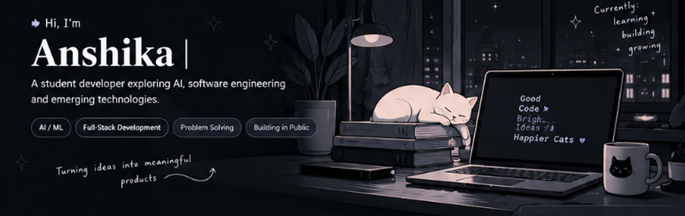
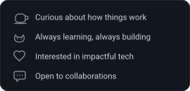
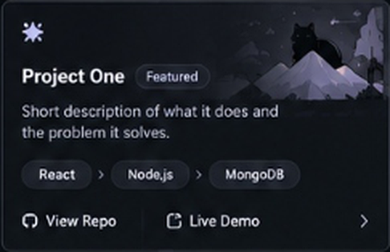
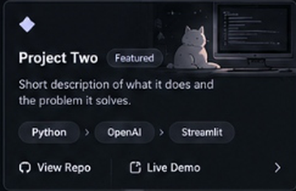
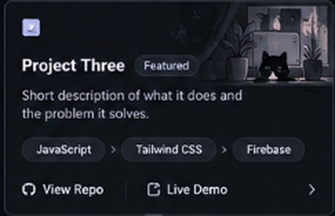
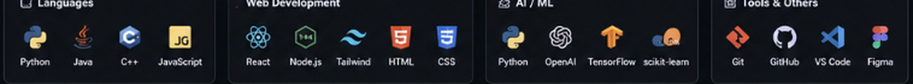
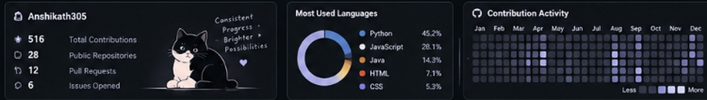

<!-- HERO BANNER -->

 

<!-- ABOUT ME SECTION -->
##  &nbsp; About Me

<table border="0" style="width: 100%; border: none; background: transparent;">
  <tr style="border: none; background: transparent;">
    <td width="64%" valign="top" style="border: none; background: transparent; padding-right: 18px;">
      

        I'm <strong>Anshika</strong>, a student developer who loves turning ideas into real-world solutions. I'm passionate about <strong>artificial intelligence</strong>, <strong>software engineering</strong>, and <strong>emerging technologies</strong>, with a focus on building products that can make a positive impact.
      

      

        My technical interests balance AI experimentation, robust full-stack development, and solid algorithmic problem-solving. When I'm not coding, you'll probably find me exploring new tech stacks, solving DSA problems, or spending time with cats.
      

    </td>
    <td width="36%" valign="top" align="center" style="border: none; background: transparent;">
      
    </td>
  </tr>
</table>

 

<!-- CURRENT FOCUS -->
### ✦ Current Focus & Learning

- 🧠 **AI & Emerging Technologies:** Experimenting with agentic AI architectures, computer vision, and trustworthy machine learning pipelines.
- 🛠️ **Full-Stack Engineering:** Building modular, scalable web platforms using modern frameworks, clean REST/FastAPI services, and intuitive UI design.
- 🧩 **Problem Solving & Algorithms:** Actively solving data structures and algorithms challenges across competitive programming platforms.
- 📌 **Current Milestone:** *`[Editable Placeholder: Actively exploring internship opportunities & open-source collaborations]`*

 

<!-- FEATURED PROJECTS SECTION -->
## 📁 Featured Projects &nbsp; <a href="https://github.com/anshikath305?tab=repositories">View all repositories ➔</a>

> *Note: Project cards are currently structured as neutral placeholders. You can select your featured repositories and replace the links and descriptions below.*

<table border="0" style="width: 100%; border: none; background: transparent;">
  <tr style="border: none; background: transparent;">
    <!-- Project Card 1 -->
    <td width="33.3%" valign="top" style="border: none; background: transparent; padding: 4px;">
      
      

        
<b>Project One Configuration</b>

        

          <b>Name:</b> <code>[Your Project One Title]</code> 
          <b>Summary:</b> <i>Short description of what it does and the problem it solves.</i> 
          <b>Stack:</b> <code>React</code> · <code>Node.js</code> · <code>MongoDB</code> 
          <b>Links:</b> <a href="https://github.com/anshikath305/YOUR_REPO_NAME">[ 🐙 View Repo ]</a> &nbsp;|&nbsp; <a href="https://YOUR_DEMO_LINK">[ ↗ Live Demo ]</a>
        

      

    </td>
    <!-- Project Card 2 -->
    <td width="33.3%" valign="top" style="border: none; background: transparent; padding: 4px;">
      
      

        
<b>Project Two Configuration</b>

        

          <b>Name:</b> <code>[Your Project Two Title]</code> 
          <b>Summary:</b> <i>Short description of what it does and the problem it solves.</i> 
          <b>Stack:</b> <code>Python</code> · <code>OpenAI</code> · <code>Streamlit</code> 
          <b>Links:</b> <a href="https://github.com/anshikath305/YOUR_REPO_NAME">[ 🐙 View Repo ]</a> &nbsp;|&nbsp; <a href="https://YOUR_DEMO_LINK">[ ↗ Live Demo ]</a>
        

      

    </td>
    <!-- Project Card 3 -->
    <td width="33.3%" valign="top" style="border: none; background: transparent; padding: 4px;">
      
      

        
<b>Project Three Configuration</b>

        

          <b>Name:</b> <code>[Your Project Three Title]</code> 
          <b>Summary:</b> <i>Short description of what it does and the problem it solves.</i> 
          <b>Stack:</b> <code>JavaScript</code> · <code>Tailwind CSS</code> · <code>Firebase</code> 
          <b>Links:</b> <a href="https://github.com/anshikath305/YOUR_REPO_NAME">[ 🐙 View Repo ]</a> &nbsp;|&nbsp; <a href="https://YOUR_DEMO_LINK">[ ↗ Live Demo ]</a>
        

      

    </td>
  </tr>
</table>

 

<!-- TECH STACK SECTION -->
## ⚙ Tech Stack

  

 

  
<b>View detailed skills & technologies breakdown</b>

   

| Category | Technologies & Tools |
| :--- | :--- |
| **Languages** | Python, Java, C++, JavaScript, TypeScript, SQL |
| **Web & Frameworks** | React, Next.js, Node.js, FastAPI, Tailwind CSS, HTML5, CSS3 |
| **AI & Machine Learning** | OpenAI APIs, PyTorch, TensorFlow, scikit-learn, Computer Vision, Jupyter |
| **Tools & Platforms** | Git, GitHub, VS Code, Figma, MySQL, Postman |

 

<!-- GITHUB STATS SECTION -->
## 📊 GitHub Stats

  

 

<!-- LEARNING & COLLABORATION -->
## 🤝 Learning & Collaboration

- 💡 **What I enjoy building:** Practical software solutions combining intelligent algorithms with clean user interfaces.
- 🚀 **Looking to collaborate on:** Open-source AI tools, meaningful student initiatives, hackathons, and product prototypes.
- 💬 **Let's talk about:** Applied machine learning, full-stack architecture, competitive programming patterns, or cats!

 

<!-- CONTACT & LINKS -->
## 📬 Connect With Me

&nbsp;

&nbsp;

&nbsp;

&nbsp;

 

<!-- FOOTER -->

  

